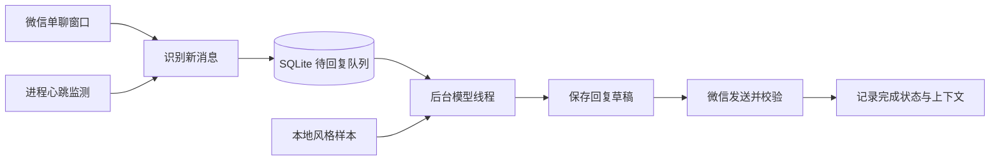

# WeChat AI Assistant · 微信智能自动回复助手

基于 Python、Windows 桌面微信 UI 自动化和大模型的个人聊天助手。支持文字回复、图片识别、聊天风格参考，以及消息队列持久化和异常恢复。

**仅监听配置的单聊联系人。双击启动器会自动发送回复；首次测试建议先使用预览模式。**

## 功能

- **文字与图片**：文字直接生成回复；图片先识别，再结合对话生成回复。
- **个人口吻**：导入聊天文本，按精确说话人提取本人用语，检索与当前话题相关的历史回复示例。
- **持续接收**：模型请求在后台线程执行，主线程继续读取微信消息。
- **断点恢复**：SQLite 保存待回复消息、草稿和发送进度；临时失败时保留任务并重试。
- **进程监测**：心跳监测、请求时限、异常重启及进程锁，减少长时间卡住和重复运行。
- **发送校验**：发送后检查消息气泡；重试前核对保存的草稿是否已经发出，减少重复发送。
- **多联系人**：最多配置 5 位好友，每位好友的队列和上下文独立。

## 运行环境

- Windows 10 / 11，Python 3.10+。
- 已登录的桌面微信。本项目使用 UI 自动化，不是微信官方 API；微信界面版本变化可能影响兼容性。
- 已开通相应模型的 DeepSeek 或阿里云百炼 API Key。

默认配置将文本与图片请求分开处理。模型名由 `config.json` 决定，需使用服务端实际支持的模型；文本模型也可通过 `model` 字段修改。

## 快速开始

克隆仓库后，在项目目录打开 PowerShell：

```powershell
py -m venv .venv
.\.venv\Scripts\python.exe -m pip install -r requirements.txt
Copy-Item .env.example .env
Copy-Item config.example.json config.json
```

编辑本机 `.env`，填写密钥：

```dotenv
AI_PROVIDER=deepseek
DEEPSEEK_API_KEY=YOUR_API_KEY
DEEPSEEK_BASE_URL=https://api.deepseek.com
```

使用百炼时，把 `AI_PROVIDER` 改为 `bailian`，填写 `DASHSCOPE_API_KEY` 和对应的 `BAILIAN_BASE_URL`。不同地域或业务空间应使用自己的 API Host。

编辑本机 `config.json`，把 `allowed_friends` 改成微信中的**精确备注名或显示名**：

```json
{
  "allowed_friends": ["测试好友"],
  "model": "auto",
  "vision_model": "auto",
  "style": "自然、简短、直接，像日常微信聊天",
  "display_name": "你的微信昵称",
  "real_name": "",
  "poll_seconds": 0.5,
  "max_pages": 3,
  "max_messages_per_batch": 5,
  "max_reply_chars": 120,
  "ai_disclosure": "（AI助手代回）"
}
```

`real_name` 可以留空。`ai_disclosure` 控制回复后缀，留空时不附加标签；对方明确询问是否由 AI 代回时，会如实说明。

### 先测试模型与预览

以下模拟命令不会读取或发送微信消息：

```powershell
.\.venv\Scripts\python.exe wechat_ai.py --check-model
.\.venv\Scripts\python.exe wechat_ai.py --simulate "今晚打游戏吗"
.\.venv\Scripts\python.exe wechat_ai.py --simulate-image "C:\图片\测试.png" --simulate "这是什么？"
```

打开微信并登录，然后监听配置好友的新消息，只在终端预览：

```powershell
.\.venv\Scripts\python.exe wechat_ai.py
```

按 `Ctrl+C` 停止预览。

### 启动自动发送

1. 保持电脑不锁屏、不休眠，微信窗口可正常操作。
2. 双击 **[启动自动回复.cmd](./启动自动回复.cmd)**。
3. 查看终端中的联系人与运行状态，保持启动窗口打开。
4. 双击 **[停止自动回复.cmd](./停止自动回复.cmd)**，或在启动窗口按 `Ctrl+C` 停止。

启动器默认自动发送，并在进程异常时重启。首次启动会处理窗口中最近一次本人发言之后可见的未回复消息。

### 修改联系人

先停止助手，在 `config.json` 中修改：

```json
"allowed_friends": ["好友备注"]
```

保存并重新启动。可配置多个联系人，例如 `["测试好友A", "测试好友B"]`；不支持通配符或自动回复所有好友。

## 导入个人风格

准备微信复制或导出的文本，格式为“说话人 / 日期时间 / 正文”：

```text
测试好友
2026年01月01日 12:00
打游戏吗

你的微信昵称
2026年01月01日 12:01
行 玩啥
```

导入时指定你在记录中的精确名字：

```powershell
.\.venv\Scripts\python.exe -X utf8 wechat_style.py "C:\聊天记录.txt" --owner "你的微信昵称"
```

结果写入本机 `style_examples.json`，重启助手后生效。导入会覆盖已有风格资料；会排除重复记录和明显的账号、密码等内容，但自动筛选不能保证去掉所有个人信息，应在使用前自行检查。

也可以停止监听后，从配置的单聊读取最近的记录：

```powershell
.\.venv\Scripts\python.exe wechat_ai.py --learn-style 200
```

提取时应只配置 1 位好友。此命令同样会覆盖已有样本。

风格适配通过**提示词与相关示例检索**实现，不训练或修改模型权重。历史示例只参考表达方式，不应作为当前经历、行程或承诺。

## 工作流程



消息和进度保存在 `.wechat_ai_runtime.sqlite3`。主循环每 5 秒产生内部心跳，30 秒没有心跳时启动器重启工作进程。模型请求有总时限，失败任务会退避重试。日志在 `logs/wechat_ai.log`，自动轮换保存。

`max_messages_per_batch` 是兼容字段；当前队列会保留所有已经识别到的新消息，连续消息可以合并为一次回复。

## 隐私与密钥

公开仓库只包含程序、测试、空白配置示例和上游开源资料。以下内容已加入 `.gitignore`：

- `.env` 及其本地变体：API 密钥和服务配置。
- `config.json`：联系人、昵称、姓名和个人口吻。
- `style_examples.json`：本人用语及聊天示例。
- `.wechat_ai*`、SQLite 数据库、`logs/`：消息队列、上下文和运行日志。
- 虚拟环境、IDE 文件、聊天导出目录及压缩包。

调用模型时，当前消息、选中的上下文、风格示例和图片资料会发送到配置的模型服务。请确认接收方同意相关测试和数据处理，保管好本机数据。

提交前运行检查；该检查只报告文件名与问题类型，不输出密钥原文：

```powershell
.\.venv\Scripts\python.exe scripts/check_public_files.py
```

检查会扫描 Git 暂存区，拦截禁止公开的文件、常见令牌格式，以及本机 `.env` 中的密钥原文。不要使用 `git add -f` 强制提交个人文件。

## 测试

```powershell
.\.venv\Scripts\python.exe -X utf8 -m unittest -q test_wechat_ai.py test_runtime.py test_wechat_lock.py test_wechat_style.py test_public_files.py
```

测试使用模拟模型和临时数据库，不依赖 API Key，不会向真实微信发送消息。覆盖消息筛选、图片请求结构、后台接收、持久化恢复、发送重试、进程监测、Windows 文件锁及风格导入。GitHub Actions 在 Windows 上执行测试与公开文件检查。

## 已知限制

- 只处理配置的单聊，不监听群聊。
- 图片读取可见缩略图，小字和细节可能不清楚。
- 语音、文件、视频只根据可见类型或标题回复，不识别其具体内容。
- 网络中断、锁屏、界面遮挡、窗口关闭或微信升级可能影响读取与发送。
- 消息校验与持久化可减少重复发送，不能保证所有异常下完全不漏读、不重复。
- 当前提示词以中文日常社交为主，部分称谓背景固定为男生与女生，其他场景需要调整提示词。

## 项目文件

| 文件 | 用途 |
| --- | --- |
| `wechat_ai.py` | 配置、模型调用、微信 UI 读写与回复规则 |
| `wechat_runtime.py` | SQLite 队列、上下文与后台模型调度 |
| `run_wechat_ai.py` | 进程监督、异常重启与停止入口 |
| `wechat_lock.py` | Windows 进程互斥锁 |
| `wechat_style.py` | 聊天文本解析与相关示例检索 |
| `config.example.json` / `.env.example` | 不含个人数据的配置模板 |
| `scripts/check_public_files.py` | Git 暂存区的敏感文件检查 |
| `goutoujunshi-main/` | 上游聊天 skill 与参考资料 |

## 开源来源

- 聊天原则与参考资料来自 [powerycy/goutoujunshi](https://github.com/powerycy/goutoujunshi)，已保留其 [MIT 许可证](./goutoujunshi-main/LICENSE) 和原始说明。
- 微信自动化依赖 [Hello-Mr-Crab/pywechat](https://github.com/Hello-Mr-Crab/pywechat)，通过 `requirements.txt` 中固定的源码提交安装。

本项目采用 [MIT License](./LICENSE)。第三方资料与依赖按各自许可证使用。
